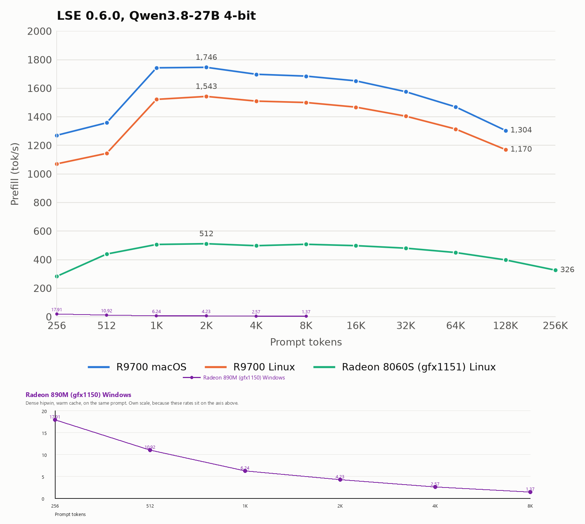
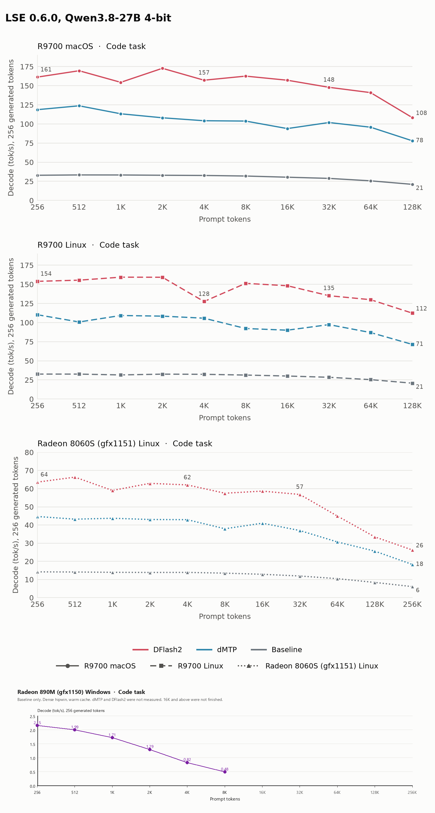
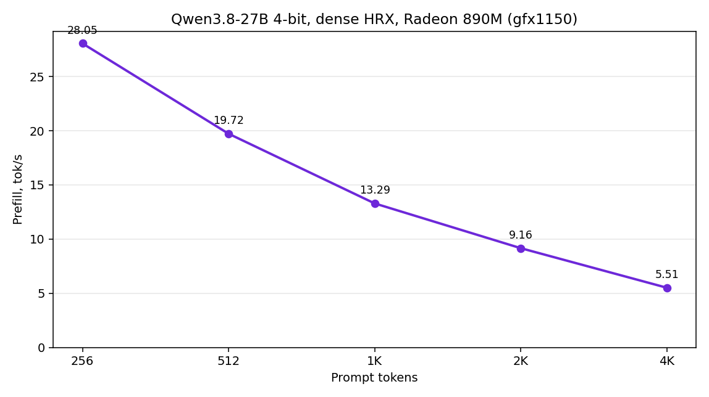
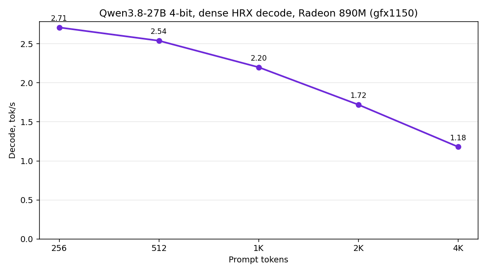

# Lemon Seed Engine (LSE)

LLM inference engine for AMD GPUs on Linux, macOS, iPadOS and Windows.

LSE records a model's forward pass as a graph, fuses operations, and generates kernels for the GPU it runs on. On Linux, macOS and iPadOS, kernels are emitted in the Loom dialect, compiled by loomc for the device's gfx target, launched through HRX, and kept in an on-disk cache. Kernel shapes come from device facts (compute units, LDS, wave size, matrix units) and per-architecture tables for gfx1201 and gfx1151. Where a kernel has several layouts, LSE runs each on the GPU, drops any whose output does not match, keeps the fastest, and saves the choice. MTP and DFlash2 speculative decoding, with draft trees, pick how many draft tokens to verify at each step from measured acceptance and the verify cost measured on that GPU. FlashPrefill V2 makes long prompt prefill sparse. LSE runs Qwen3.5-family models from MLX 4-bit and 8-bit checkpoints, with FP16, BF16 or FP8 KV caches, on the amdgpu KFD driver on Linux and the mac_linuxgpu driver on macOS and iPadOS. It ships an OpenAI-compatible HTTP server, a CLI and a C library (libLSE).

On Windows, `hrx.dll` loads the in-tree `hsa-runtime64.dll` and does not import `amdhip64`. The hipwin backend emits HIP, compiles it with amd_comgr from the ROCm 7.1 SDK, and launches through the HIP runtime. Both have run on a Radeon 890M (gfx1150). The tables below include that GPU twice. The row with no backend name is dense hipwin, warm kernel cache, CPU fallback off. The HRX row is dense HRX (`--pool hrx:0 --dialect hip`), the same prompt and the same rules, with MTP off. The prompt is HumanEval/0 (`has_close_elements`) padded with the token " the". FlashPrefill is not used. Hipwin lengths above 8K were not finished. HRX is measured at 256, 512, 1K, 2K, and 4K tokens. The 4K HRX run sets `--kv-len 4352` because the default KV cap is 4096 and that prompt otherwise leaves no room to decode. HRX dMTP is measured at a 256-token prompt only. DFlash2 was not measured on this GPU.

Multi-GPU and multi-node support is in progress. `--pool` can already name several GPUs: the loader splits each layer across them, or gives each a run of layers, and the scheduler copies between them peer to peer. This path has no published results yet. TCP and Unix-socket transports exist and are tested, but do not carry inference traffic yet. The next step extends kernel generation and placement across several GPUs and machines, choosing how to split work from measured link latency and bandwidth so that adding devices never slows a single-device run.

## Performance

Prefill, tok/s:

| GPU | OS | 256 | 1K | 2K | 4K | 32K |
| --- | --- | ---: | ---: | ---: | ---: | ---: |
| Radeon 8060S (gfx1151) | Linux | 463 | 499 | 512 | 522 | 480 |
| Radeon AI PRO R9700 | iPadOS (LemonSeed Studio) | Results pending | | | | |
| Radeon AI PRO R9700 | Linux | 1,155 | 1,424 | 1,463 | 1,501 | 1,394 |
| Radeon AI PRO R9700 | macOS | 1,393 | 1,489 | 1,536 | 1,666 | 1,563 |
| Radeon 890M (gfx1150) | Windows | 17.91 | 6.24 | 4.23 | 2.57 | — |
| Radeon 890M (gfx1150), HRX | Windows | 28.05 | 13.29 | 9.16 | 5.51 | — |

Decode, code prompt, tok/s:

| GPU | OS | Baseline | dMTP | DFlash2 |
| --- | --- | ---: | ---: | ---: |
| Radeon 8060S (gfx1151) | Linux | 14.1 | 46.2 | **63.2** |
| Radeon AI PRO R9700 | iPadOS (LemonSeed Studio) | Results pending | | |
| Radeon AI PRO R9700 | Linux | 32.5 | 114.3 | **140.1** |
| Radeon AI PRO R9700 | macOS | 33.1 | 125.2 | **164.0** |
| Radeon 890M (gfx1150) | Windows | 2.15 | — | — |
| Radeon 890M (gfx1150), HRX | Windows | 2.71 | 2.28 | — |

Model: Qwen3.8-27B, 4-bit (MLX); drafts: dMTP (dynamic MTP) 8-bit, DFlash2 8-bit.

The Radeon 890M (gfx1150) row is this machine, Windows hipwin. Prefill and baseline decode use a warm kernel cache and the HumanEval/0 prompt padded with the token " the". Each run generated 256 tokens; the decode rate is the engine's figure for the 255 sampled tokens. The 256-token prompt is the decode-table cell. The charts also show 512 and 8K. 16K and above were not finished, so the 32K cell is empty. dMTP and DFlash2 were not measured on this GPU. The purple series is drawn on its own scale under each chart, because these rates sit on the axis of the published 0–2000 and 0–175 figures.

The HRX row is the same machine and the same prompt, MTP off. The warm 256-token run printed prefill 28.05 tok/s and decode 2.71 tok/s (255 sampled tokens in 94.121 s). The warm 512-token run printed prefill 19.72 tok/s and decode 2.54 tok/s (255 sampled tokens in 100.562 s). The warm 1024-token run printed prefill 13.29 tok/s and decode 2.20 tok/s (255 sampled tokens in 115.851 s). The warm 2048-token run printed prefill 9.16 tok/s and decode 1.72 tok/s (255 sampled tokens in 148.448 s). Those four runs had compile 0.000 s. The 4096-token run printed prefill 5.51 tok/s and decode 1.18 tok/s (255 sampled tokens in 215.743 s), with `--kv-len 4352`, compile 1.879 s, host groups 0, and fallbacks 0. The decode-table cell stays the 256-token figure. The 512-token rates are not a table column. The 1K prefill cell is 13.29, the 2K cell is 9.16, and the 4K cell is 5.51. The 32K HRX cell is empty. The HRX dMTP cell is one warm 256-token run with the 8-bit MTP head at depth 3: prefill 27.10 tok/s, decode 2.28 tok/s, 191 of 191 draft tokens accepted, compile 0.000 s, host groups 0, and fallbacks 0. DFlash2 is still empty. The two charts below are the hipwin series and the other published GPUs. The HRX charts after them are this machine only.



Prefill vs prompt length



Decode vs context, code task



HRX prefill vs prompt length on this Radeon 890M. Dense, MTP off, 256 generated tokens. The 4K point uses `--kv-len 4352`.



HRX decode vs prompt length on this Radeon 890M. The decode rate is the 255 sampled tokens.

## Install

| OS | Requirements | Archive |
| --- | --- | --- |
| Linux x86_64 | amdgpu kernel driver with KFD, read/write access to `/dev/kfd` and `/dev/dri/renderD*`, glibc 2.38+ | `lse-v0.6.1-linux-x86_64.tar.gz` |
| macOS 15+, Apple Silicon | [mac_linuxgpu](https://github.com/lemonade-sdk/mac_linuxgpu) driver build 266+ and an external AMD GPU | `lse-v0.6.1-macos-arm64.tar.gz` |
| Windows x64 | LLVM 21.1.8 `clang-cl`, MSVC STL, CMake 3.30+, Ninja, Rust. hipwin needs the ROCm 7.1 SDK (`HIP_PATH`) | none; build from source |

Download from [Releases](https://github.com/Geramy/LSE/releases), check, extract and list devices:

```bash
asset=lse-v0.6.1-linux-x86_64        # or lse-v0.6.1-macos-arm64
url=https://github.com/Geramy/LSE/releases/download/v0.6.1
curl -fL -O "$url/$asset.tar.gz" -O "$url/$asset.tar.gz.sha256"
shasum -a 256 -c "$asset.tar.gz.sha256"
tar -xzf "$asset.tar.gz" && cd "$asset"
./lse --devices                       # macOS: programs are in bin/
```

The Linux and macOS archives bundle HRX, Loom and the HSA runtime. No ROCm install is needed for those archives. On Linux, add your user to the `render` and `video` groups if `--devices` shows no HRX device.

Windows has no release archive. The build copies `hsa-runtime64.dll` and ROCm 7.1's `amd_comgr_3.dll` next to `lse.exe`. The compiler DLL has to sit there: Windows searches System32 before `PATH`, and a different `amd_comgr_3.dll` in System32 is not the 7.1 compiler. Set `HIP_PATH` and `ROCM_PATH` to the ROCm 7.1 root so the device libraries come from that SDK. `lse --devices` prints `toolchains: hip` under `hipwin:0` when the compiler is linked.

## Quick start

```bash
./lse-server pull mlx-community/Qwen3.5-0.8B-4bit
./lse-server --model mlx-community/Qwen3.5-0.8B-4bit --pool hrx:0 --kv-len 32768
```

The server listens on `http://127.0.0.1:8080/v1` (Chat Completions and Completions). See the [API reference](docs/API.md).

On Windows, hipwin is `--pool hipwin:0 --dialect hip`. The measured HRX generate used `--pool hrx:0 --dialect hip`.

## Flags

`lse-server` flags. `lse` takes the same model, device, KV and decoding flags; run `lse --help` for its sampling flags.

| Flag | Default | What it does |
| --- | --- | --- |
| `-m`, `--model NAME` | `$LSE_MODEL` | Checkpoint directory, `.safetensors` file, or cached HF repo `ORG/NAME[@REV]`. |
| `--pull` | off | Download `--model`, `--mtp` or `--dflash2-model` first if not cached. |
| `--offline` | off | Never use the network. |
| `--tokenizer REPO` | `Qwen/Qwen3.6-27B` | HF repo for `tokenizer.json` when the model has none. |
| `--host ADDR` | `127.0.0.1` | Address to bind. |
| `--port N` | `8080` | Port to bind. |
| `--api-key KEY` | none | Require `Authorization: Bearer KEY`. |
| `--served-name ID` | model argument | Model ID reported by `/v1/models`. |
| `--temperature F` | model | Default request temperature, 0 to 2. |
| `--max-tokens N` | `0` (no cap) | Cap on generated tokens per request. |
| `--max-sessions N` | `8` | Sessions kept between requests; `0` is no limit. |
| `--session-memory-budget BYTES` | `0` (no limit) | KV and state all sessions may hold before idle ones are evicted. |
| `--shutdown-grace-seconds N` | `30` | Time to drain requests on shutdown, 1 to 600. |
| `--pool LIST` | `$LSE_POOL`, else first backend | Devices to use, for example `hrx:0`, `hipwin:0` or `cpu:0`. |
| `--dialect NAME` | `loom` | Kernel source dialect. hipwin declares `hip`. |
| `--no-cpu-fallback` | off | Fail instead of running any operation on the CPU. |
| `--cache-dir PATH` | `~/.lse/cache` | Compiled kernel cache. |
| `--kv-len N` | model, 2048 to 4096 | KV cache capacity in tokens. |
| `--kv-cache-dtype TYPE` | `bf16` for BF16 models, else `fp16` | K/V storage: `fp32`, `fp16`, `bf16`, `fp8` or `bf8`. |
| `--batch-size N` | `1024` | Prompt tokens per batch; power of two, 128 to 4096. |
| `--ubatch-size N` | `1024` | Tokens per prefill pass; power of two, at most `--batch-size`. |
| `--FlashPrefillV2=on\|off` | on where supported | Sparse prompt prefill; default on for Qwen3.5-family models on gfx1201 and gfx1151 with Loom and BF16 or FP32 KV. |
| `--attention-prefill MODE` | `dense` | Experimental: `dense`, `blasst` or `flashprefill-v2`. |
| `--attention-decode MODE` | `dense` | Experimental: `dense` or `blasst`. |
| `--attention-calibration FILE` | none | JSON phase scales; required for `blasst`. |
| `--no-mtp` | off | Decode one token per pass. |
| `--mtp PATH` | beside model, else paired head | MTP module: directory, `.safetensors` or HF repo. |
| `--mtp-depth N` | `3` | MTP proposals per verify pass, 1 to 7. |
| `--adaptive-mtp=on\|off` | on | Sampled requests draft as deep as measured cost allows, up to 7. |
| `--dflash2=on\|off` | off | Use the DFlash2 draft model instead of MTP. |
| `--dflash2-model PATH` | paired draft | DFlash2 directory or HF repo; BF16 is converted to Q8 on first use. |
| `--adaptive-dflash2=on\|off` | on | Verify the proposal prefix expected to decode fastest; off verifies all seven. |
| `--dflash2-tree=on\|off` | follows `--adaptive-dflash2` | Verify a tree of draft candidates per target pass. |
| `--model-info` | off | Print model facts as JSON and exit. |
| `--estimate[=JSON]` | off | Print the device memory the other flags would allocate and exit. |
| `--perplexity FILE` | none | Score a UTF-8 text file, print JSON and exit. |
| `--perplexity-tokens FILE` | none | Score a JSON array of token IDs instead. |
| `--perplexity-method M` | `chunks` | `chunks` (llama.cpp method) or `sliding`. |
| `--perplexity-ctx N` | `512` | Tokens per chunk or window. |
| `--perplexity-stride N` | ctx | Tokens between sliding windows. |
| `--perplexity-chunks N` | all | Score only the first N chunks. |
| `--perplexity-kld-base-out FILE` | none | Record a KL-divergence base. |
| `--perplexity-kld-top-k K` | `32` | Token IDs per position in that base, 1 to 32. |
| `--perplexity-kld FILE` | none | Compare against a recorded base. |
| `--perplexity-output PATH` | stdout | Where to write the perplexity JSON. |
| `--perplexity-token-ids` | off | Include token IDs in the perplexity JSON. |

Model commands: `lse-server models` lists cached MLX models, `lse-server pull ORG/NAME[@REV]` downloads one, `lse-server models rm ORG/NAME --yes` removes one. Add `--help` to each for options.

## Environment variables

| Variable | Default | What it does |
| --- | --- | --- |
| `LSE_MODEL` | none | Default for `--model`. |
| `LSE_POOL` | none | Default for `--pool`. |
| `LSE_DEVICE` | `0` | Device ordinal when no pool is given. |
| `LSE_BACKEND` | `hrx`, then `hipwin`, then `cpu` | Use only the named backend. Unset tries that order and keeps the first that comes up. |
| `LSE_CACHE_DIR` | `~/.lse/cache` | Kernel cache; `--cache-dir` takes precedence. |
| `LSE_REQUIRE_DEVICE_KERNELS` | unset | `1` is the same as `--no-cpu-fallback`. |
| `LSE_AUTOTUNE` | on | `off` or `0` disables kernel variant trials. |
| `LSE_AUTOTUNE_BUDGET_MS` | `20000` | Time budget for kernel variant trials. |
| `LSE_CHECK_BINDINGS` | unset | Any value checks each launch's buffers for liveness, bounds and signature. |
| `LSE_DFLASH2_AUTOCONVERT` | `1` | `0` loads a BF16 DFlash2 draft without Q8 conversion. |
| `LSE_DFLASH2_CACHE_DIR` | `lse-q8g64/` beside the draft | Where converted Q8 drafts are stored. |
| `LSE_DFLASH2_TREE_NODES` | `15` | Node count of a fixed draft tree (`--dflash2-tree=on --adaptive-dflash2=off`). |
| `LSE_MODEL_DIRS` | none | Extra checkpoint directories for `models`, `:`-separated. |
| `LSE_PROFILE_DISPATCH` | off | `submit` or `serial` dispatch profiling. |
| `HF_HUB_CACHE`, `HF_HOME` | `~/.cache/huggingface/hub` | Hugging Face cache location. |
| `HF_TOKEN` | unset | Token for gated repos; falls back to `$HF_HOME/token`. |
| `HF_ENDPOINT` | `https://huggingface.co` | Hub mirror. |
| `HF_HUB_OFFLINE` | unset | `1` is the same as `--offline`. |

## Links

- [Build from source](BUILD_FROM_SOURCE.md); CMake options and the iOS XCFramework: [build instructions](BUILD_INSTRUCTIONS.md)
- Docs: [API](docs/API.md), [client compatibility](docs/CHAT-COMPATIBILITY.md), [DFlash2](docs/DFLASH2.md), [KV cache](docs/KV_CACHE.md), [perplexity](docs/PERPLEXITY.md), [benchmarks](docs/benchmarks/), [release history](docs/RELEASE_HISTORY.md), C API [`include/lse/lse.h`](include/lse/lse.h)
- Related: [mac_linuxgpu](https://github.com/lemonade-sdk/mac_linuxgpu), [amdgpu_mtopg](https://github.com/lemonade-sdk/amdgpu_mtopg), optional [RDNA4 KFD patch](https://github.com/lemonade-sdk/mac_linuxgpu/blob/main/patches/linux/kfd-v12-mqd-vram.patch) for Linux
- FlashPrefill V2: research by [shcherbakov22](https://github.com/shcherbakov22/), [paper](https://arxiv.org/html/2608.19758v1)
- License: [MIT](LICENSE.md)
